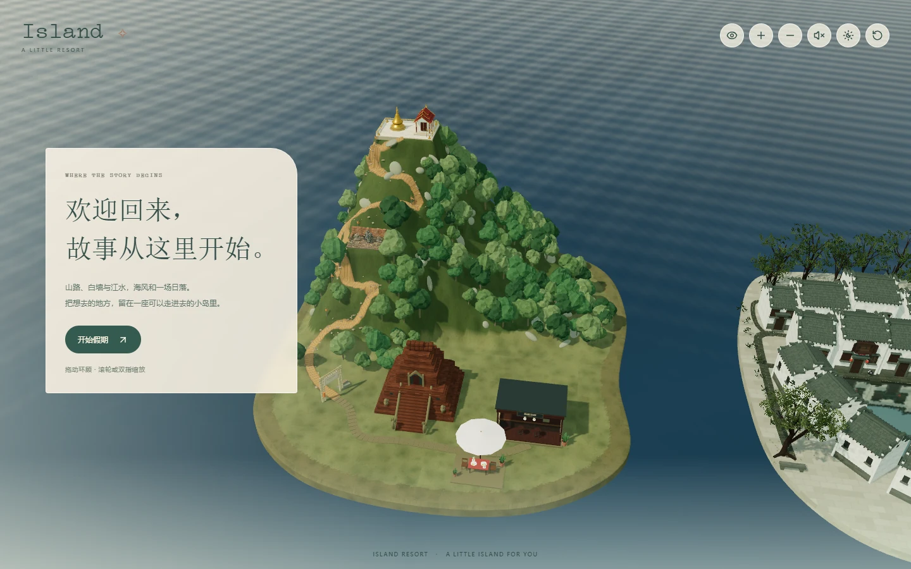

# Island Resort · 小岛度假村

[](LICENSE)
[](#快速开始)

一座可以走进去的 **3D 旅行纪念页模板**：拖动环顾一座小岛，切换四个旅行地点，点开照片卡，在岛心的海边长桌完成一次小小的庆祝。React 19 + TypeScript + Vite 7 + React Three Fiber，没有后端，MIT 许可。



> 把想去的地方，留在一座可以走进去的小岛里。

## 这是什么

Island Resort 是一个开源的 3D 场景模板，适合做成旅行纪念页、毕业纪念、纪念日页面，或者送给某个人的一份「可以走进去」的礼物。它把四个旅行地点装进同一座小岛：清迈的山路与古寺、宏村的白墙黛瓦与月沼、阳朔的江水与群山、亚庇的海边度假村，一共 **20 个可点击的地点（spot）**。

所有示例内容都可以替换：品牌名、欢迎语、庆祝流程与信、四个地点、20 个 spot 的标题与照片、背景音乐、字体、昼夜节奏和配色。把 `public/` 里的示例照片换成自己的照片，再改两个配置文件，就能变成你自己的版本。

**在线体验**：本仓库不附带官方演示地址。你可以先在本地 `npm run dev` 看效果，或按下面的「部署」一节部署自己的版本。

## 岛上有什么

- **四个旅行地点，20 个 spot**：顶部切换清迈 / 宏村 / 阳朔 / 亚庇，或切到「四地全景」一次看完整座岛；底部导航对应每个地点的 spot。
- **自由环顾**：拖动旋转视角，滚轮或双指缩放；右上角还有放大 / 缩小与「恢复全景视角」。
- **照片卡**：点击场景里的相机标记或底部导航打开照片卡；多图可左右翻页，竖长图自动展开，横图可「展开照片看细节」。
- **走近看看**：照片卡里的「走近看看」可以切换到对应地点的近景视角，看完一键回到全景。
- **昼夜流转**：一个完整昼夜 **8 分钟**，可暂停在「白天 / 日落 / 夜晚」；灯光、星星、月亮、萤火虫和海水颜色一起变化。
- **庆祝流程**：岛心海边的长桌 → 点蜡烛 → 许愿 → 吹灭 → 打开信封读信 → 可以「再庆祝一次」。文案全部来自 `src/site.ts`。
- **声音**：背景音乐默认静音，用户点声音按钮后才播放；亚庇场景额外有实时合成的海浪声。
- **纯观景模式**：一键隐藏场景里的相机标记并暂停场景点击，安心看造景；底部导航仍可打开照片卡。
- **可验证、可维护**：文案与素材集中管理；`npm test` 覆盖昼夜循环、光照、文案与素材一致性、本机路径检查；GitHub Actions 自动跑测试与构建。
- **尊重系统设置**：适配 `prefers-reduced-motion`，开启「减少动态效果」时镜头与动画会收敛。

## 示例插画


`public/examples/` 里的 **22 张示例插画**与 `public/music/island-theme.wav`（32 秒无缝循环）都由仓库里的 Python 脚本程序生成，`public/favicon.svg` 是项目图标：没有真人照片、没有外部图片、没有版权录音。它们的来源、重新生成命令与替换方法见 [docs/ARTWORK.md](docs/ARTWORK.md)。

## 快速开始

需要 **Node.js 22.12+**（见 `package.json` 的 `engines`）和 npm。项目没有后端、API Key 或数据库，示例素材已经包含在仓库里。

```sh
npm ci
npm run dev
```

打开终端显示的地址（通常是 `http://localhost:5173`），点「开始假期」就能进岛。

构建与本地预览生产版本：

```sh
npm run build     # TypeScript 检查 + Vite 构建，输出 dist/
npm run preview   # 本地预览构建结果，默认 http://localhost:4173
```

## 可用脚本

| 命令 | 作用 |
| --- | --- |
| `npm run dev` | 启动开发服务器（`vite --host 0.0.0.0`），保存即热更新 |
| `npm run build` | 先 `tsc -b` 做类型检查，再 `vite build` 输出 `dist/` |
| `npm run preview` | 以生产构建启动本地预览 |
| `npm test` | Node 测试：昼夜循环与光照（`tests/dayCycle.test.ts`）、文案与素材一致性及本机路径检查（`tests/site.test.ts`） |
| `npm run check` | 一次跑完测试与构建（`npm test && npm run build`）；测试中包含文案/素材一致性与本机路径检查 |
| `npm run format` | 用 Prettier 格式化全部文件 |
| `npm run format:check` | 只检查格式，不改文件 |
| `npm run assets:images` | 重新生成 `public/examples/` 的 22 张示例插画与 `docs/` 里的预览图（需要 Python + Pillow + numpy） |
| `npm run assets:music` | 重新生成 `public/music/island-theme.wav` 示例音乐（只需要 Python） |

## 项目结构

```text
island-resort/
├─ .github/
│  ├─ workflows/ci.yml          push / PR 时跑测试与构建
│  ├─ ISSUE_TEMPLATE/           Bug 与功能建议表单
│  └─ pull_request_template.md
├─ docs/
│  ├─ REMIX.md                  完整二创教程：换文案、照片、音乐、字体、昼夜与配色
│  ├─ ARTWORK.md                示例插画的来源、重新生成与替换
│  ├─ QA.md                     发布前人工检查清单
│  ├─ preview.webp              项目截图
│  └─ artwork-preview.webp      示例插画拼贴
├─ public/
│  ├─ examples/                 22 张程序生成的示例插画（WebP）
│  ├─ fonts/                    OFL 字体子集与许可文件
│  ├─ music/                    island-theme.wav（32 秒示例音乐）
│  └─ favicon.svg
├─ scripts/
│  ├─ generate_examples.py      生成示例插画的脚本
│  └─ generate_music.py         生成示例音乐的脚本
├─ src/
│  ├─ site.ts                   品牌、欢迎卡、庆祝文案与信、音乐、页脚
│  ├─ main.tsx                  React 入口
│  └─ resort/
│     ├─ ResortApp.tsx          页面外壳：导航、照片卡、声音、键盘与纯观景模式
│     ├─ ResortWorld.tsx        3D 世界入口、相机与轨道控制
│     ├─ data.ts                四个地点、20 个 spot 的标题/介绍/照片/坐标
│     ├─ dayCycle.ts            昼夜调色板与 8 分钟循环
│     ├─ views.ts               「走近看看」的近景镜头
│     ├─ resort.css             页面样式与 @font-face
│     └─ *Scene.tsx 等          各地区的场景组件
├─ tests/
│  ├─ dayCycle.test.ts          昼夜循环、光照与时间推进测试
│  └─ site.test.ts              文案/素材一致性、示例 WAV 规格、本机路径检查
├─ index.html                   页面标题、描述、主题色与图标
├─ package.json / package-lock.json
├─ tsconfig.json / vite.config.ts
├─ vercel.json                  Vercel 框架、构建与缓存配置
└─ README.md / LICENSE / CONTRIBUTING.md / CODE_OF_CONDUCT.md / SECURITY.md / CHANGELOG.md
```

## 改成自己的版本

| 想改什么 | 改哪里 | 详细教程 |
| --- | --- | --- |
| 品牌名、欢迎卡、加载提示、页脚 | `src/site.ts` | [改品牌与欢迎语](docs/REMIX.md#改品牌与欢迎语) |
| 庆祝四步、祝福、信封里的信 | `src/site.ts` 的 `celebration` | [改庆祝文案与信](docs/REMIX.md#改庆祝文案与信) |
| 四个地点的显示名与副标题 | `src/resort/data.ts` 的 `regions` | [改四个地点与 20 个 spots](docs/REMIX.md#改四个地点与-20-个-spots) |
| 20 个 spot 的标题、介绍、底部导航顺序 | `src/resort/data.ts` 的 `spots`、`regionSpots` | 同上 |
| 照片 | `public/examples/` 或新建 `public/photos/`，同步 `src/resort/data.ts` | [替换照片](docs/REMIX.md#替换照片) |
| 背景音乐 | `public/music/` + `src/site.ts` 的 `music` | [替换音乐](docs/REMIX.md#替换音乐) |
| 字体 | `public/fonts/` + `src/resort/resort.css` 的 `@font-face` | [换字体](docs/REMIX.md#换字体) |
| 昼夜节奏与手动时间点 | `src/resort/dayCycle.ts` 的 `DAY_CYCLE_SECONDS`、`TIME_MODE_HOURS` | [改昼夜节奏](docs/REMIX.md#改昼夜节奏) |
| 页面配色 | `src/resort/resort.css`，3D 基调在 `src/resort/dayCycle.ts` | [改配色](docs/REMIX.md#改配色) |
| 近景镜头 | `src/resort/views.ts` | [改近景镜头](docs/REMIX.md#改近景镜头) |
| 图标、页面标题与描述 | `public/favicon.svg`、`index.html` | [改图标与页面元信息](docs/REMIX.md#改图标与页面元信息) |

完整的分步教程（含可直接照做的代码示例、常见问题与检查清单）见 **[docs/REMIX.md](docs/REMIX.md)**。

## 部署

### 部署到 Vercel

1. 把项目推送到 GitHub（见下一节）。
2. 打开 [vercel.com](https://vercel.com) → **Add New… → Project** → 导入仓库。
3. 按下面的配置确认（通常会被自动识别；`vercel.json` 已声明框架、构建与缓存）：

| 配置项 | 值 |
| --- | --- |
| Framework Preset | Vite |
| Build Command | `npm run build` |
| Output Directory | `dist` |
| Install Command | `npm ci` |
| Node.js Version | 22.x |

4. 点 Deploy，完成后会得到一个 `https://<project>.vercel.app` 地址。

### 部署路径

页面里的照片、音乐和字体使用**以 `/` 开头的绝对路径**（例如 `/examples/sabah-sunset.webp`、`/music/island-theme.wav`、`/fonts/island-latin.woff2`），因此推荐部署在**独立域名或子域名的根路径**（Vercel 的 `*.vercel.app` 属于根路径）。

把构建产物放到子路径（例如 GitHub Pages 项目页 `https://YOUR_USERNAME.github.io/island-resort/`）时，绝对路径会 404，需要额外修改 Vite 的 `base`、`index.html`、`src/site.ts`、`src/resort/data.ts` 与 `resort.css` 里的资源路径；本仓库不提供开箱即用的子路径配置。如果必须用 GitHub Pages，可以部署到用户/组织的根站点并绑定自定义域名。

## 上传到 GitHub

### 方式一：网页上传（不需要装 Git）

1. 在本地把项目目录整理好，确保根目录包含 `package.json`、`src/`、`public/` 等文件（不要只上传压缩包，GitHub 不会自动解压）。
2. 在 GitHub 点 **New repository**，仓库名填 `island-resort`，选择 Public 或 Private，不要勾选自动生成 README，然后创建。
3. 在新仓库页点 **Add file → Upload files**，把解压后的全部文件与文件夹拖进去（这会保留目录结构）。
4. 在下方填写提交信息，例如 `Initial commit: Island Resort`，点 **Commit changes**。
5. 如果一次拖不下（GitHub 网页单次上传有数量和大小限制），可以分批上传剩下的文件；空目录需要至少放一个文件才会出现。

网页上传适合少量修改；后续维护建议用命令行或 GitHub Desktop。

### 方式二：命令行

先在 GitHub 创建空仓库（不要勾选初始化 README），然后在项目目录执行：

```sh
git init
git add .
git commit -m "Initial commit: Island Resort"
git branch -M main
git remote add origin https://github.com/YOUR_USERNAME/island-resort.git
git push -u origin main
```

把 `YOUR_USERNAME` 换成你自己的 GitHub 用户名（或组织名）。如果仓库地址不同，同步替换远程地址即可。`.gitignore` 已经排除了 `node_modules/`、`dist/`、`.env*`、日志和本地输出，无需手动删除这些文件。

## 隐私与素材政策

这是一个公开仓库：**`public/` 下的所有文件都会被直接访问**，部署后照片、音乐和字体都是公开资源。请遵守：

- 不要提交真人照片、合影、带人脸的截图、私人信件/聊天记录或真实姓名。
- 不要提交他人的可版权录音、影视/游戏素材、带水印的图片。
- 上传照片前移除 EXIF 与定位信息，并确认画面中的人同意公开。
- 示例素材（插画、音乐、图标）只是演示，可以删除或替换；换成自己的内容时，请确认你有权公开。
- 如果你是在别人的小岛基础上二创，公开前请先得到对方同意。

`npm test` 中的 `tests/site.test.ts` 会检查文案与素材是否一致，并确认源码里没有本机路径；提交前请运行一次。

## 测试与 CI

```sh
npm test    # 昼夜循环、光照、时间推进 + 文案/素材一致性、示例 WAV 规格、本机路径检查
npm run check   # test + build
```

GitHub Actions（[`.github/workflows/ci.yml`](.github/workflows/ci.yml)）会在 push 和 Pull Request 时，用 Node 22 + npm 缓存执行 `npm ci` → `npm test` → `npm run build`。浏览器端的人工检查清单见 [docs/QA.md](docs/QA.md)。

## 许可与致谢

- **代码**：MIT 许可，见 [LICENSE](LICENSE)。保留上游版权行 `Copyright (c) 2026 Iris Zhou`，并加入二创版版权行 `Copyright (c) 2026 leo`。
- **上游项目**：[An Island for You](https://github.com/carpediemzzsssww-cpu/island-for-you)（© 2026 Iris Zhou，MIT）。本项目的场景与交互基于其公开版二创。
- **字体**：`public/fonts/` 中的 Compagnon Roman 子集按 SIL Open Font License 1.1 分发；完整版权与许可文本见 [`public/fonts/LICENSES.md`](public/fonts/LICENSES.md) 与 [`public/fonts/font-licenses.json`](public/fonts/font-licenses.json)。
- **示例插画与示例音乐**：由本仓库的 `scripts/generate_examples.py`、`scripts/generate_music.py` 程序生成；`public/favicon.svg` 是随仓库提供的简单矢量图标。均不包含真人照片、外部图片或版权录音，来源说明见 [docs/ARTWORK.md](docs/ARTWORK.md)。
- 上游项目不对本二创版本背书；如发现问题，请在本仓库提交 Issue。

## 贡献

欢迎提交 Issue 和 Pull Request。开始之前请阅读：

- [CONTRIBUTING.md](CONTRIBUTING.md)：开发环境、提交流程、文案与素材的改动方式
- [CODE_OF_CONDUCT.md](CODE_OF_CONDUCT.md)：社区行为准则
- [SECURITY.md](SECURITY.md)：如何私下报告安全问题

大范围改动（新增场景、重做交互、引入依赖）建议先开 Issue 讨论方向。

## 常见问题

**第一次打开没有声音？**
背景音乐默认静音，必须在用户手势之后才能播放：点右上角的声音按钮即可。浏览器不允许页面自动播放音频，这是预期行为。

**提示 Node 版本不支持？**
项目要求 Node.js 22.12+（`package.json` 的 `engines`）。用 `node -v` 检查；项目根目录的 `.nvmrc` 是 `22.12.0`，可以用 `nvm use` 切换。

**照片 404 或者显示不出来？**
`src/resort/data.ts` 里的 `src` 必须以 `/` 开头，并指向 `public/` 下真实存在的文件（如 `/examples/sabah-sunset.webp`），文件名大小写也要一致。替换图片后运行 `npm test` 可以检查引用与文件是否对得上。

**字体显示成方框？**
仓库里的字体是只覆盖常用拉丁字符的 OFL 子集，中文会回退到系统字体（苹方 / 微软雅黑等）。想换字体见 [docs/REMIX.md](docs/REMIX.md#换字体)。

**手机上有点卡？**
首次进入需要加载 3D 场景和贴图，耐心等加载提示消失。避免在低端设备上同时打开多个标签页；照片建议压到最长边 1600 px 以内、使用 WebP，减少单张体积。

**刷新后回到欢迎页了？**
这是预期行为：项目不写本地存档，刷新会重置欢迎卡、默认地点（清迈）、自动昼夜和静音状态。

**为什么没有后端 / 访问统计？**
这是一个纯静态模板，没有账号、数据库或追踪脚本；所有内容都在浏览器里运行。

## English

**Island Resort** is a 3D travel-memento template built with React 19, TypeScript, Vite 7 and React Three Fiber. Explore a small island with four travel regions and 20 clickable spots, switch the time of day, open photo cards, take a closer look at selected places, and run a short celebration at the seaside table.

- **Run locally**: Node.js 22.12+, then `npm ci` and `npm run dev` (`npm run build` → `dist/`, `npm run preview`).
- **Customize**: brand, welcome copy, celebration and letter in `src/site.ts`; the four regions and 20 spots (titles, descriptions, photos, positions, bottom navigation) in `src/resort/data.ts`. The full guide is in [docs/REMIX.md](docs/REMIX.md) (Chinese).
- **Demo assets**: 22 illustrations and a 32-second music loop are procedurally generated by the Python scripts in `scripts/`; the favicon is a simple SVG. No real photos or copyrighted recordings are included.
- **Deploy**: Vercel with the Vite preset (`npm run build`, output `dist/`). Assets use absolute `/` paths, so deploy at the root of a domain.
- **Tests**: `npm test` covers the day/night cycle, copy/asset consistency and a local-path check; `npm run check` runs tests plus a production build.
- **License**: code is MIT — upstream "An Island for You" © 2026 Iris Zhou plus this edition © 2026 leo; fonts are OFL. See [LICENSE](LICENSE) and [docs/ARTWORK.md](docs/ARTWORK.md).
